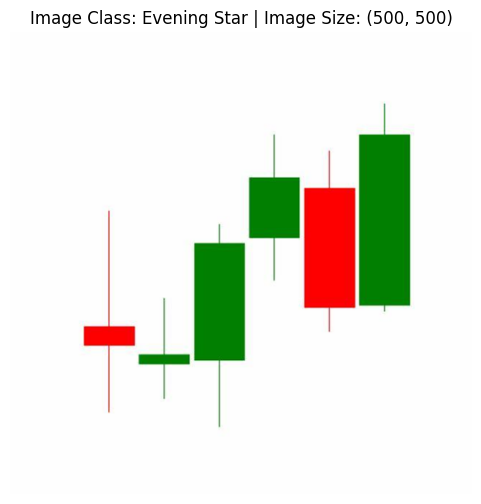
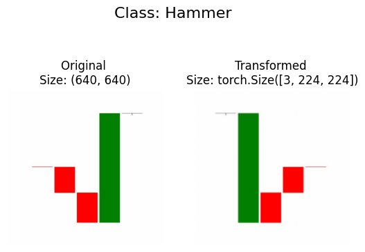

# PyTorch for Finance: Deep Learning Notebooks

Deep learning with PyTorch, applied to financial data. The notebooks go from
tensors and training loops to classification and computer vision, and end with
a convolutional neural network that classifies candlestick chart patterns.



## Notebooks

| # | Notebook | What it covers |
|---|---|---|
| 00 | [`00_pytorch_fundamentals`](notebooks/00_pytorch_fundamentals.ipynb) | Tensors, operations, reproducibility, GPU use |
| 01 | [`01_pytorch_workflow`](notebooks/01_pytorch_workflow.ipynb) | End-to-end workflow: data split, training loop, loss curves, saving models |
| 02 | [`02_ML_and_classification`](notebooks/02_ML_and_classification.ipynb) | Classification with PyTorch: loss functions, optimisers, logits to predicted labels |
| 03 | [`03_pytorch_computer_vision`](notebooks/03_pytorch_computer_vision.ipynb) | Image datasets, batching, convolutional networks |
| 04 | [`04_custom_dataset_candlestick_cnn`](notebooks/04_custom_dataset_candlestick_cnn.ipynb) | **Candlestick pattern recognition**: a CNN trained on labelled chart images |

## Candlestick pattern recognition

Notebook 04 uses a labelled dataset of candlestick chart images from Roboflow,
labelled by pattern (for example Hammer and Evening Star), then trains a CNN to recognise
them. The preprocessing step resizes each chart and converts it to a tensor
for the network.



## Running the notebooks

The notebooks were written in Google Colab. Run them there, or locally with the packages below.

```bash
pip install torch torchvision torchmetrics torchinfo matplotlib numpy pandas scikit-learn mlxtend roboflow tqdm
```

Notebook 04 downloads its dataset from Roboflow. Set your own key before running it:

```bash
export ROBOFLOW_API_KEY="your-key-here"
```

Notebooks 02 and 03 download a small `helper_functions.py` from the course
repository when they run.

## Credits

The structure and most of the teaching material in notebooks 00–03 come from
Daniel Bourke's [PyTorch for Deep Learning](https://github.com/mrdbourke/pytorch-deep-learning)
course. The candlestick dataset and CNN in notebook 04 are my own work.
